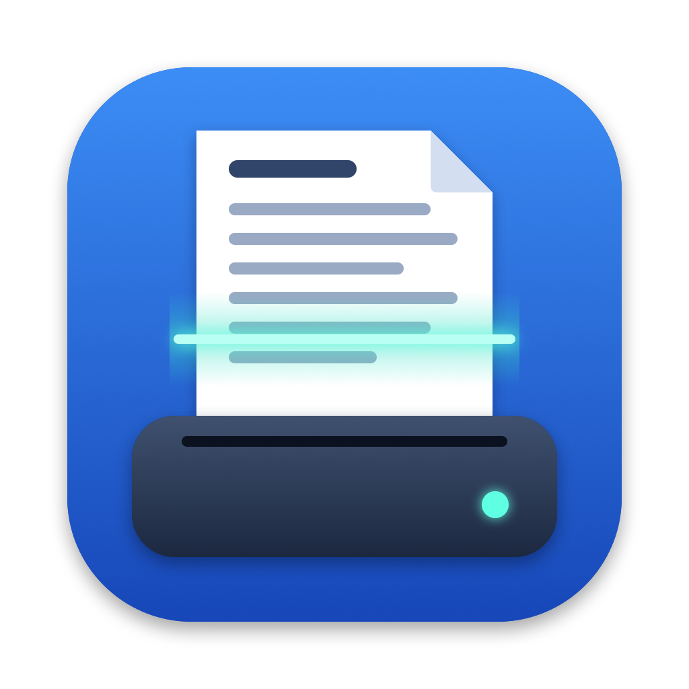

# OutilScan

🇫🇷 [Version française](README.md) · 🇬🇧 English

macOS app (Apple Silicon) to scan with **Fujitsu ScanSnap S1500 and S1300** scanners, single or double-sided, to a multi-page PDF with OCR.

ScanSnap Home does not support these models: the app drives them through the free **SANE** driver (`fujitsu` backend for the S1500, `epjitsu` for the S1300). It reads each scanner's capabilities (resolutions, modes) and only shows the settings it accepts. When several scanners are connected, a menu lets you choose.

## Drivers

| Scanner | SANE driver | Extra file |
|---|---|---|
| ScanSnap S1500 / S1500M | `fujitsu` | none |
| ScanSnap S1300 | `epjitsu` | firmware `1300_0C26.nal` |

The SANE driver is installed with Homebrew (see *Installation*).

### S1300 firmware

The S1300 must receive a Fujitsu firmware file, `1300_0C26.nal`, every time it is powered on. **This file belongs to Fujitsu/PFU: it is not shipped with SANE or in this repository, and cannot be added to it.** PFU stopped distributing ScanSnap Manager on 7 November 2024, and the old download links no longer work.

Where to find it:
- on the **CD-ROM** that came with the scanner (inside the ScanSnap Manager installer);
- on a **Windows PC** where ScanSnap Manager is installed: `C:\Windows\twain_32\ScanSnap\1300_0C26.nal` (or search for `*.nal`);
- in an old **ScanSnap Manager for S1300** installer (`WinS1300ManagerV55L10WW.exe` or a similar version) you may have kept; the file can be extracted without running the installer, for example with `unshield` (`brew install unshield`).

When OutilScan detects an S1300 without firmware, the **Import firmware…** button copies the file to the right place and keeps a backup: after a `brew upgrade`, the app reinstalls it automatically.

## Installation

**Without compiling**: download the `OutilScan-<version>.dmg` file of the latest version from the [Releases](https://github.com/adnmac/OutilScan/releases/latest) page, drag the app into Applications, then install the SANE driver (`brew install sane-backends`).

**From source**:

```bash
brew install sane-backends
./build-app.sh --install
```

The script compiles with the Command Line Tools only (Xcode is not required) and copies `OutilScan.app` to `/Applications`.

To install on another Mac, `./make-dmg.sh` creates `build/OutilScan-<version>.dmg` (the app, a shortcut to Applications and installation notes). The app only has an ad hoc signature: on another Mac, open it the first time with right-click > Open.

## Usage

1. Connect the scanner via USB and open its cover (this turns it on).
2. Choose single or double-sided, colour, resolution and paper size; straightening, background clean-up and blank pages are set in the sidebar.
3. **Scan** (⌘N) — scanning again adds the pages after the existing ones. Each page is straightened and cleaned (fold shadows, text showing through from the back) as soon as it arrives.
4. Reorder by drag and drop, rotate or delete (hover or right-click); double-click to enlarge and browse pages with ← →.
5. **Save PDF** (⌘S): the file name `YYMMDD-SENDER-Title` (e.g. `261012-CHULILLE-Facture-Soins`) is suggested from the document's content, by Apple Intelligence on the Mac (macOS 26+) or by simple rules. Your corrections are remembered. The PDF contains the recognised text (OCR in French, Dutch, English and German).

**Preferences** (OutilScan menu > Settings…, ⌘,): appearance (system, light or dark) and interface language (English, French, German, Italian), applied instantly.

If the scanner is not found: quit ScanSnap Home and VueScan (only one program can use it at a time), then click Refresh. From the command line: `scanimage -L`.

## Development

- `swift build` — compile
- `swift run OutilScan` — run the app without packaging
- `swift run OutilScanSelfTest` — tests (XCTest and Swift Testing require Xcode, hence this executable)
- `swift run OutilScanSelfTest --analyze file.pdf` — replays the file-name suggestion on a PDF
- `./make-dmg.sh` — creates the installation disk image
- `swift Resources/make-icon.swift` — redraws the icon (`Resources/AppIcon.icns`)

With the macOS 27 SDK, `@State` is a macro whose plugin only ships with Xcode: the views use the `@ViewState` alias instead (see `Sources/OutilScan/ViewState.swift`).

The source code comments are written in French.

## License

Code released under the [MIT](LICENSE) license. SANE, Homebrew and the Fujitsu firmware remain subject to their own licenses.
